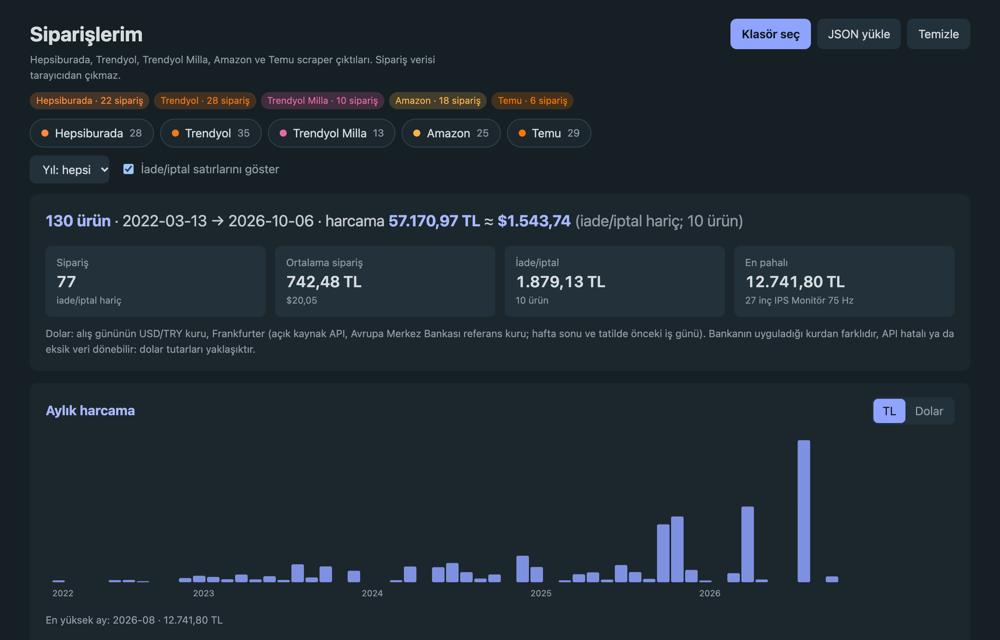
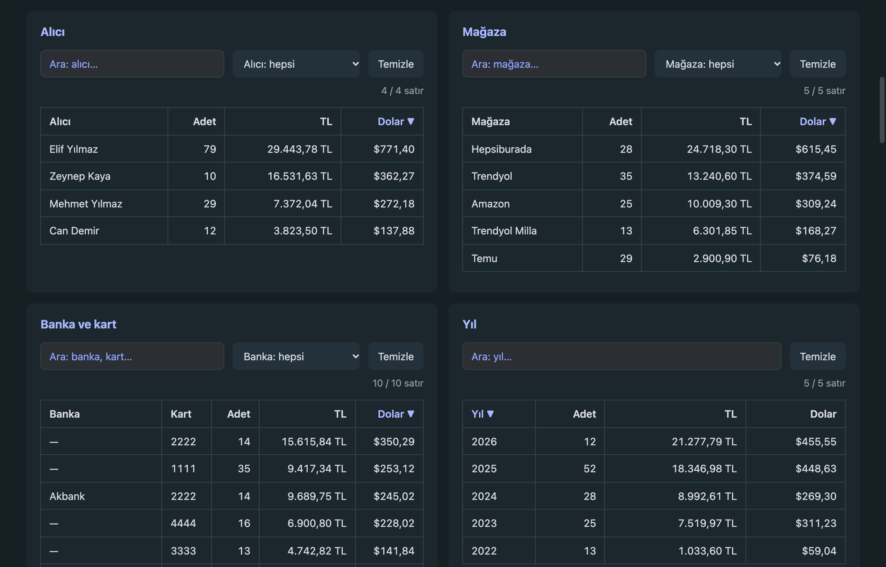
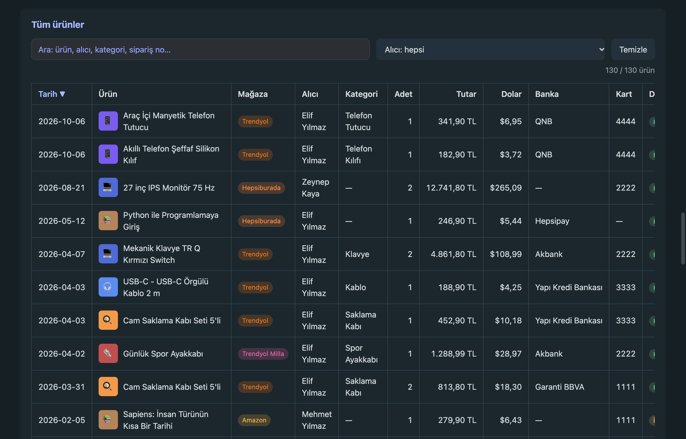
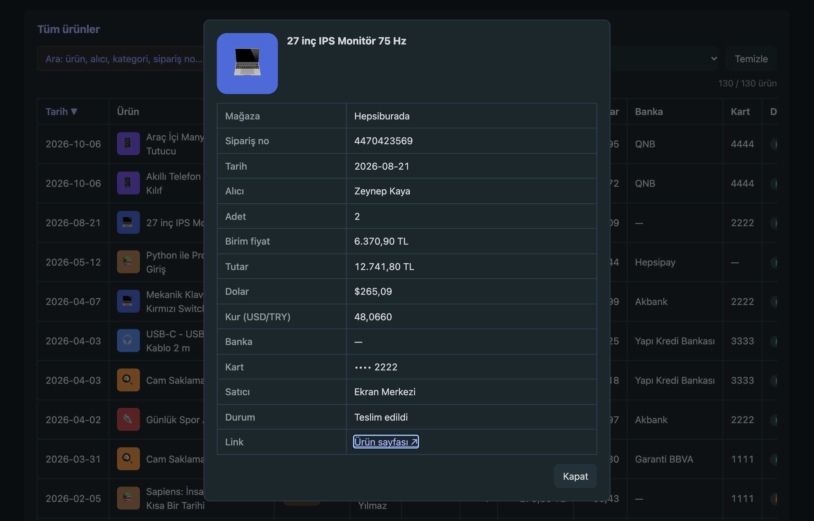

# tr-shop-order-exporter

Hepsiburada, Trendyol, Trendyol Milla, Amazon TR ve Temu sipariş geçmişini tarayıcı Console'undan JSON olarak indirir.
Resmî API yok. Scraper'lar sitenin kendi sayfa/API isteklerini **okur**; sipariş vermez, hiçbir şeyi değiştirmez.
İnen dosyaları tek sayfalık [gösterge paneli](#gösterge-paneli-indexhtml) özetler: kurulum, sunucu ya da Python gerekmez.



> **Not:** Scraper'lar en son **8 Ekim 2026**'da (Temu **30 Ekim 2026**'da) güncellendi. Siteler arayüzünü veya iç API'sini değiştirdiğinde bozulabilir; güncel olmayabilir ve çalışmayabilir.

## Hızlı başlangıç

1. Siteye giriş yap, **Siparişlerim** sayfasını aç, `F5` ile yenile.
2. İlgili scraper dosyasının tamamını kopyala (`Cmd+A`, `Cmd+C`).
3. `F12` → **Console**'a yapıştır, Enter. "allow pasting" uyarısı çıkarsa önce `allow pasting` yaz, sonra yeniden yapıştır.
4. Console filtresine etiketi yaz (aşağıdaki tablo). Sayfanın kırmızı hataları gizlenir, yalnızca ilerleme görünür.
5. Sol altta ilerleme kutusu çıkar. Bitince JSON iner; Console'daki `hatalar:` satırı kaç hata olduğunu söyler.

| Site | Scraper | Başlangıç sayfası | Etiket | İnen dosya |
|---|---|---|---|---|
| Hepsiburada | `hepsiburada/hepsiburada-scraper.js` | hepsiburada.com/siparislerim | `[HB]` | `hepsiburada-siparisler.json` |
| Trendyol | `trendyol/trendyol-scraper.js` | trendyol.com/hesabim/siparislerim | `[TY]` | `trendyol-siparisler.json` |
| Trendyol Milla | `trendyol-milla/trendyol-milla-scraper.js` | trendyol-milla.com/hesabim/siparislerim | `[MILLA]` | `trendyol-milla-siparisler.json` |
| Amazon TR | `amazon/amazon-scraper.js` | amazon.com.tr → Siparişlerim | `[AMZ]` | `amazon-siparisler.json` |
| Temu | `temu/temu-scraper.js` | temu.com/tr/bgt_orders.html | `[TEMU]` | `temu-siparisler.json` |

### Tarih aralığı / son N sipariş

Scraper'ı yapıştırınca sayfada **Hangi siparişler alınsın?** kutusu çıkar: Tümü, son 1 / 3 / 6 ay, son 1 yıl, özel tarih aralığı ya da son N sipariş. Seçip **Başlat**'a bas.

Kutuyu atlamak için scraper'dan önce Console'a `window.RANGE = { months: 3, from: null, to: null, last: null }` yaz (`from` / `to`: `'YYYY-AA-GG'`).

Liste en yeniden eskiye gittiği için tarih alt sınırında tarama durur. `to` ile eski bir aralık isterken aradaki yeni siparişler de taranır (atlanır), bu yüzden biraz daha yavaş olabilir. Temu'da iade listesi yine tam okunur. Kutu yalnız Console'da çalışan scraper'a aittir; `index.html` paneli siteye bağlanamaz.

Aynı sekmede ikinci kez çalıştırmadan önce `F5` yap. Hepsiburada ve Trendyol kodları fonksiyona sarılı değil, tekrar yapıştırınca çakışır.

## Çıktı

- **Sipariş:** no, tarih, durum, toplam, teslimat adresi (alıcı, adres, il/ilçe, maskeli telefon).
- **Ödeme:** yöntem, kart son haneleri, banka/taksit, kargo, indirim kalemleri.
- **Ürün (satır bazlı):** ad, adet, fiyat, ürün kodu, link, görsel, satıcı, durum, kargo firması ve takip no, teslim tarihi.
- Bulunamayan alan `"-"` olur. Hatalı sipariş `error` alanıyla kayda girer, diğerleri devam eder.

Fiyat alanları siteye göre değişir:

| Site | Alanlar |
|---|---|
| Hepsiburada | `price` = satır toplamı (adet dahil), `unitPrice` = birim fiyat |
| Trendyol / Milla | `unitPrice` = birim fiyat, `lineTotal` = adet × birim |
| Amazon | `unitPrice` = birim fiyat, `lineTotal` = adet × birim (KDV dahil sayfa fiyatı) |
| Temu | `unitPrice` = birim fiyat, `lineTotal` = adet × birim; ithalat vergisi yalnız sipariş toplamında (`payment.importTax`) |

Alan yapısını `examples/*-siparisler.example.json` dosyalarında görebilirsin. Örneklerdeki kişiler, adresler, sipariş ve kart numaraları uydurmadır; ürün görselleri `examples/img/` altındaki basit simgelerdir.

## Gösterge paneli (`index.html`)

İndirilen JSON'ları tek sayfada özetler. Yalnız HTML, CSS ve JS; kurulum, derleme ya da sunucu gerekmez.

1. Scraper'ların indirdiği JSON'ları bir klasöre koy (ör. `data/`, git'e girmez). Adlarını değiştirme: dosyalar `<site>-siparisler*.json` adından tanınır. İkinci bir hesabın dosyası `<site>-<ek>-siparisler.json` adıyla (ör. `trendyol-hesap2-siparisler.json`) aynı mağazaya eklenir.
2. `index.html`'i tarayıcıda aç, **Klasör seç**'e tıkla, klasörü seç.
3. Chrome/Edge klasörü hatırlar: sonraki açılışta **Klasörü oku**, yeni dosya ekleyince **Yenile**. Brave, Safari ve Firefox hatırlamaz; her açılışta yeniden seç. Tarayıcı güvenliği gereği yerel bir sayfa klasörü kendiliğinden okuyamaz, en az bir tıklama gerekir.

Denemek için `examples/` klasörünü seç: klasörde gerçek dosya yoksa örnekler (`*.example.json`) yüklenir. Dosyaları sayfaya sürüklemek ya da **JSON yükle** de çalışır.

**Neler var**

- **Özet satırı:** ürün sayısı, tarih aralığı, harcama TL ve dolar (iade/iptal hariç), fiyatı bilinmeyen ürünler; altında sipariş sayısı, ortalama sipariş, iade/iptal tutarı, en pahalı ürün.
- **Genel filtreler:** mağaza çipleri, yıl, iade/iptal satırlarını gizle/göster. Bütün tablolar ve grafik bunlara göre güncellenir.
- **Aylık harcama grafiği:** TL / dolar.
- **Özet tabloları:** alıcı, mağaza, banka ve kart, yıl, kategori. Her tabloda arama, açılır filtre, sıralama.
- **Tüm ürünler:** arama, alıcı filtresi, sıralama, sayfalama; satıra tıklayınca ayrıntı penceresi.







*Görüntüler `examples/` içindeki uydurma verilerle alındı.*

**Hesaplama kuralları**

- **Harcama:** durumu iade ya da iptal olmayan ürün satırlarının toplamı. Adet sütunları iade/iptal dahil tüm satırları sayar.
- **Banka:** yalnız site veriyorsa görünür (şu an yalnız Trendyol). Diğerlerinde `—`; kartsız ödemede yöntem yazılır (Hepsipay, Trendyol Cüzdan, Hediye çeki).
- **Dolar:** alış gününün USD/TRY kuru, [Frankfurter](https://frankfurter.dev) (açık kaynak API, Avrupa Merkez Bankası referans kuru; hafta sonu ve tatilde önceki iş günü). API'ye yalnız tarih aralığı gönderilir, kurlar tarayıcıda (`localStorage`) saklanır. Bankanın uyguladığı kurdan farklıdır ve API hatalı/eksik dönebilir: **dolar tutarları yaklaşıktır.** API'ye ulaşılamazsa dolar sütunları boş kalır.
- **Fiyatı olmayan ürün:** sipariş tek ürünlüyse sipariş toplamı kullanılır ve `≈` ile işaretlenir.
- **Temu:** ürün satırları gümrük (ithalat) vergisini içermez, sipariş toplamı içerir. Panel ürün başına şunları gösterir (yalnız **Temu** çipi tek seçiliyken: özet satırının altında Temu net dökümü, tabloda Ürün tutarı / Gümrük / Ödenen / İade / Net sütunları; ayrıntı penceresinde her zaman):
  - **Gümrük vergisi:** siparişte ödenen ithalat vergisi, ürünlere satır tutarı oranında.
  - **Ödenen:** sipariş toplamının ürün payı (vergi dahil, kupon/kredi sonrası).
  - **İade:** Temu'nun iade kayıtları (vergi iadesi dahil), kaydın kapsadığı ürünlere ödenen oranında; kaydı olmayan iade (ör. iptal sipariş) siparişin tüm ürünlerine.
  - **Net = Ödenen − İade.** Tabloda Temu ürünlerinin **Tutar**'ı her zaman nettir (tüm mağazalar seçiliyken de). Harcamaya net girer; tamamı iade edilen ürün iade sayılır (net 0), kısmi iadede net düşer.
  - Dağıtımlar çıkarımdır. "Fiyat ayarlaması" iadelerinin tutarı Temu verisinde yok; bu ürünlerin neti fazla görünebilir.

**Yapı**

```
index.html
web/css/style.css
web/js/util.js              biçimlendirme, tarih/tutar ayrıştırma, durum sınıflandırma
web/js/rates.js             USD/TRY kuru (Frankfurter + önbellek)
web/js/adapters/*.js        site başına: sipariş JSON'u -> ortak ürün satırı
web/js/data.js              dosya tanıma, birleştirme, filtre durumu
web/js/folder.js            klasör seçimi
web/js/components/table.js  aranabilir, sıralanabilir tablo
web/js/views/*.js           özet, grafik, tablolar, ürün listesi
web/js/app.js               bağlama
```

Dosyalar klasik `<script>` ile yüklenir (ES module değil), böylece sayfa `file://` üzerinden de çalışır. Yeni site eklemek için `web/js/adapters/` altına `detect(order)` ve `toItems(order)` içeren bir dosya yaz, `index.html`'e ve `data.js`'teki site listelerine ekle.

## Siteye özel notlar

**Trendyol:** Sitenin iç sipariş API'sini kullanır (liste `api/orders`, detay `m-order-detail`). Fiyatı olmayan tek ürünlü siparişte fiyat ara toplamdan hesaplanır ve `priceEstimated: true` yazılır. Cüzdan ödemeleri `Cüzdan` olarak işaretlenir. Bazı ürünlerde kategori `"-"` gelir.

**Trendyol Milla:** Trendyol ile aynı altyapı ve kod. Fark: alan adı, `channelId=8`, dosya adı, etiket. Beden/renk `variant` alanında.

**Hepsiburada:** Sayfayı sonuna kadar kaydırır, her siparişi açıp ekrandan okur. Adet `xN` rozetinden gelir. Detay 6 saniyede açılmazsa o sipariş boş kalır (`items[0].name = "-"`). Bu durum dosyaya `error` olarak yazılmaz, yalnızca Console'daki `hatalar:` listesinde görünür. Görürsen scraper'ı yeniden çalıştır.

**Temu:** Liste `api/bg/aristotle/user_order_list`, detay `bgt_order_detail.html` içindeki `window.rawData`, iadeler "İadeler" sekmesinin isteğinden okunur. Ürün satırları ithalat vergisini içermez; sipariş toplamı içerir. Temu satıcı adı, kategori, banka ve takip no vermez. Kart bazen yalnız marka olarak gelir.

**Amazon:**
- `AUTO = true` (varsayılan): yılları ve sayfaları kendisi gezer, art arda 3 boş yılda durur. `AUTO = false`: yalnızca açık sayfayı alır.
- Adet, ürün görselindeki rozetten okunur (rozet yoksa 1).
- Eski siparişlerin çoğunda Amazon durum metni vermez, ürün durumu `"-"` kalır.
- Scraper, iade penceresi metni olan ürünlere `"Teslim edildi (çıkarım)"` yazar. Bu çıkarımdır, kesin bilgi değil.
- İptal edilen siparişlerde toplam, adres ve ödeme `"-"` olur.
- `check.match: false` hata olmak zorunda değil; promosyon, vade farkı veya hediye kartı toplamı kaydırabilir.
- Captcha çıkarsa kod durur ve o ana kadarkini indirir.

## Gizlilik

- İndirilen JSON'lar kişisel veri içerir: adres, maskeli telefon, kart son haneleri. Paylaşma, herkese açık repoya koyma.
- `.gitignore` gerçek `*-siparisler.json` dosyalarını ve `data/` içindeki JSON'ları dışarıda tutar.
- Gösterge paneli veriyi yalnız tarayıcıda işler; dışarıya giden tek istek dolar kuru içindir ve yalnız tarih aralığı içerir.

## Sınırlar

- Yalnızca GET isteği atılır, istekler arasında bekleme vardır (Amazon'da daha uzun). Captcha, 403 veya "çok fazla istek" görürsen sayfayı yenile, bir süre bekle.
- Yöntem sitelerin belgelenmemiş yapısına dayanır; site değişirse scraper bozulabilir.
- Sitelerin kullanım şartlarını kontrol etmedim. Kendi hesabın ve kendi verin için kullan.
